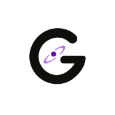
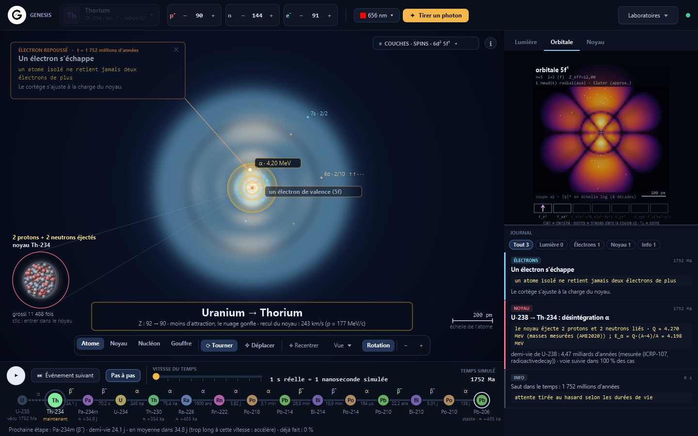
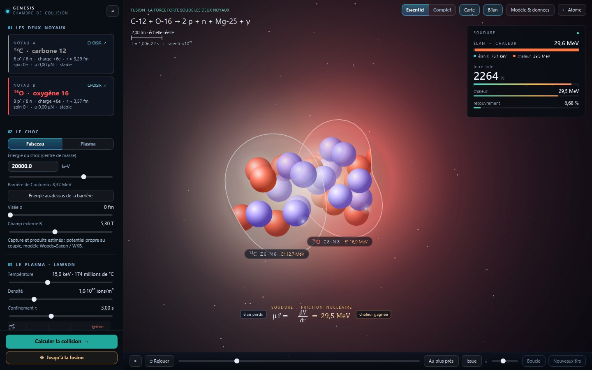
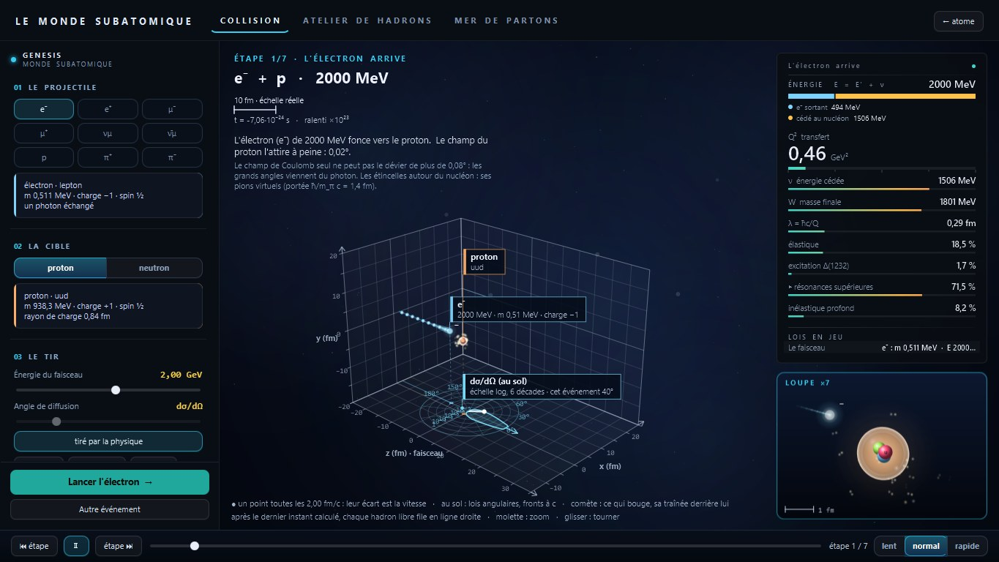

<p align="center">
  
</p>

<h1 align="center">Genesis</h1>

<p align="center">
  <b>Matter, computed before your eyes.</b><br>
  A free physics simulator for Windows, Linux and macOS: build an atom, fuse two nuclei, go all the way down to quarks.
</p>

<p align="center">
  <a href="https://github.com/Lightminedust/genesis-releases/releases/download/v0.2.0/Genesis-0.2.0.exe"><b>Download for Windows</b></a>
  ·
  <a href="https://github.com/Lightminedust/genesis-releases/releases/download/v0.2.0/Genesis-0.2.0-linux-x64.deb"><b>Download for Linux</b></a>
  ·
  <a href="https://github.com/Lightminedust/genesis-releases/releases/download/v0.2.0/Genesis-0.2.0-macos-arm64.dmg"><b>Download for macOS</b></a>
  ·
  <a href="https://genesis.gemmi-e.com">Website</a>
  ·
  <a href="README.fr.md">Lire en français</a>
</p>

<p align="center">
  
</p>

Nothing in Genesis is scripted. A Python physics engine moves time forward and applies the laws of physics; every event happens at the moment the law decides, and comes with the calculation behind it. The numbers come from reference data: NIST, NUBASE2020, AME2020, PDG, CODATA, REACLIB.

## Three laboratories

### The atom

Pick any of the 118 elements, then add or remove protons, neutrons and electrons. The atom responds: an excited electron falls back and emits a photon, an unstable nucleus decays at the moment drawn from its half-life.

- The electron cloud in 3D, shell by shell
- A tunable laser: the photon is absorbed, passes through, or knocks an electron out
- The decay chain from uranium to lead, with time you can speed up
- The nucleus seen as a vibrating drop

### Nuclear fusion



Choose any two nuclei and the collision energy. The engine computes the approach, the electric repulsion, quantum tunnelling, then what is left: a fusion, a bounce or a fission.

- The collision at its true scale, then up close at contact
- The fields and forces at work at every instant
- A detailed report: products, energy released, probabilities
- The plasma of a reactor and the core of a star

### The subatomic world



Fire an electron at a nucleon and watch what happens, assemble your own hadrons from quarks, and look inside the proton at different resolutions.

- Collisions told step by step
- A workshop to build hadrons and check whether they hold together
- The Standard Model table, every line computed or measured
- The sea of partons that appears as you look closer

## Download — version 0.2.0

| File | Use |
| --- | --- |
| [**Genesis-0.2.0.exe**](https://github.com/Lightminedust/genesis-releases/releases/download/v0.2.0/Genesis-0.2.0.exe) | Windows installer: adds Genesis to the Start menu and the desktop |
| [Genesis-0.2.0-portable.zip](https://github.com/Lightminedust/genesis-releases/releases/download/v0.2.0/Genesis-0.2.0-portable.zip) | Windows portable: extract the whole archive, then run `Genesis/Genesis.exe` |
| [**Genesis-0.2.0-linux-x64.deb**](https://github.com/Lightminedust/genesis-releases/releases/download/v0.2.0/Genesis-0.2.0-linux-x64.deb) | Debian/Ubuntu x86-64 installer: adds Genesis to the applications menu |
| [Genesis-0.2.0-linux-x64.tar.gz](https://github.com/Lightminedust/genesis-releases/releases/download/v0.2.0/Genesis-0.2.0-linux-x64.tar.gz) | Linux portable: extract, then run `Genesis/bin/Genesis` |
| [**Genesis-0.2.0-macos-arm64.dmg**](https://github.com/Lightminedust/genesis-releases/releases/download/v0.2.0/Genesis-0.2.0-macos-arm64.dmg) | macOS Apple Silicon disk image: open, then drag Genesis to Applications |
| [Genesis-0.2.0-macos-arm64.zip](https://github.com/Lightminedust/genesis-releases/releases/download/v0.2.0/Genesis-0.2.0-macos-arm64.zip) | macOS Apple Silicon portable: extract, then open `Genesis.app` |

Java and the Python engine are bundled: no separate Java or Python installation is required. Genesis runs entirely on your computer, with no account and no server. English is the default; French is available from the language menu. All versions are on the [Releases page](https://github.com/Lightminedust/genesis-releases/releases).

**First launch.** The engine loads its data, which can take several dozen seconds. A loading screen stays up until it is ready.

**Windows warning.** This version is not digitally signed yet. If Windows SmartScreen shows a warning, click **More info**, then **Run anyway**. You can check that your download is intact against the SHA-256 checksums in [CHECKSUMS-SHA256.txt](CHECKSUMS-SHA256.txt):

```powershell
Get-FileHash .\Genesis-0.2.0.exe -Algorithm SHA256
```

**Linux.** On Debian/Ubuntu, install the downloaded package with `sudo apt install ./Genesis-0.2.0-linux-x64.deb`. For the portable archive, run `tar -xzf Genesis-0.2.0-linux-x64.tar.gz` and then `./Genesis/bin/Genesis`. A desktop with GTK 3 is required. The Linux engine log is at `${XDG_STATE_HOME:-~/.local/state}/genesis/logs/engine.log`.

**macOS.** Apple Silicon (arm64) only. Open the `.dmg` and drag Genesis to Applications, or extract the `.zip` and open `Genesis.app`. The package is not notarized: if macOS blocks the first launch, right-click the app, choose **Open**, then confirm. You can also clear the quarantine flag with `xattr -dr com.apple.quarantine /Applications/Genesis.app`. The engine log is at `~/Library/Logs/Genesis/engine.log`.

**If the engine does not start**, its log is at `%LOCALAPPDATA%\Genesis\logs\engine.log` on Windows, `${XDG_STATE_HOME:-~/.local/state}/genesis/logs/engine.log` on Linux, or `~/Library/Logs/Genesis/engine.log` on macOS. Send it through the [contact page](https://gemmi-e.com/contact), along with your operating system version.

## Support the project

Genesis is designed and built independently. If you enjoy it:

- ⭐ **Star this repository.** It is the simplest way to help, and it shows me people are using it.
- 👀 **Watch → Custom → Releases** to be notified of new versions.
- Tell people about it, and send ideas or bugs through the [contact page](https://gemmi-e.com/contact).

## License

Genesis is free to install and use, for personal or professional purposes, on as many computers as you own. It is proprietary software: you may not sell, redistribute or modify it. See the full [end-user license agreement](EULA.txt). This repository contains the official downloads; the [source repository](https://github.com/Lightminedust/genesis) is maintained separately.

---

<p align="center">
  © 2026 Gemmie · <a href="https://genesis.gemmi-e.com">genesis.gemmi-e.com</a> · <a href="https://gemmi-e.com/contact">Portfolio &amp; contact</a> · <a href="https://github.com/Lightminedust">GitHub</a>
</p>
